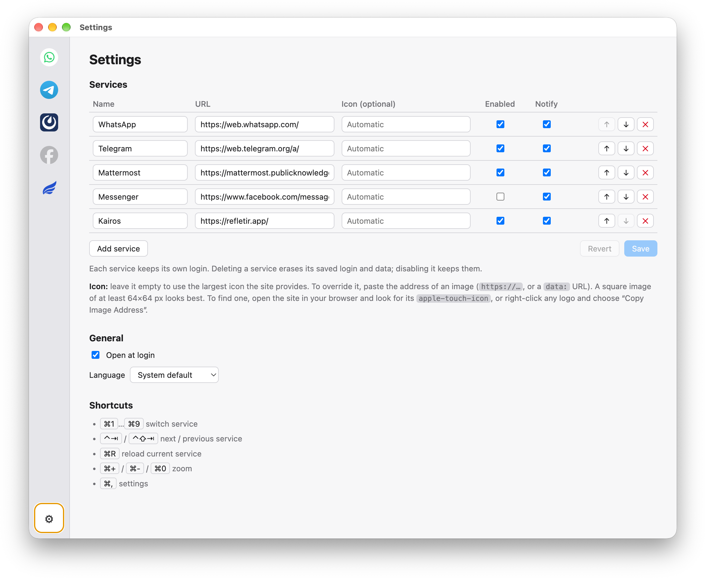

# MiniMessenger


Minimal macOS multi-messenger: the web versions of WhatsApp, Telegram, Facebook
Messenger, Mattermost (or any other web app) in one window, with native
notifications and unread badges in the sidebar and the Dock.

A small, dependency-free alternative to Rambox/Ferdium, built with Electron.

<br clear="left">

<p align="center">
  
</p>

## Features

- One sidebar entry per service, each with its own isolated, persistent login.
- Native macOS notifications; clicking one opens that service.
- Unread counts per service and in total on the Dock icon.
- Services keep running in the background when the window is closed (⌘Q quits).
- Links open in your default browser.
- English and Portuguese (Brazil) interface, following the system language by
  default (configurable in Settings).

## Requirements

- macOS (built and tested on Apple Silicon).
- [Node.js](https://nodejs.org/) 22.12 or later, with npm.

## Run from source

```bash
git clone <this repository>
cd minimessenger
npm install
npm start
```

The first `npm start` downloads the Electron binary.

## Build the app

No prebuilt binaries are published; build your own:

```bash
npm install
npm run dist
```

This creates `dist/mac-arm64/MiniMessenger.app` (`dist/mac/` on Intel Macs) and
signs it ad hoc (`codesign --sign -`), which Apple Silicon requires to run it.
There is no Apple Developer ID signature or notarization.

### Install

```bash
npm run install-app
```

This builds the app, quits a running MiniMessenger, copies the bundle to
`/Applications`, and verifies the signature. Logins are kept.

To install by hand instead:

```bash
cp -R dist/mac*/MiniMessenger.app /Applications/
xattr -dr com.apple.quarantine /Applications/MiniMessenger.app
```

An app you build yourself is not quarantined, so the `xattr` step is usually a
no-op. You need it if the bundle was downloaded or copied from another Mac
(AirDrop, zip file, browser download): macOS then marks it as quarantined and,
because it has no Developer ID signature, refuses to open it ("damaged" or
"cannot be verified"). Removing the attribute tells Gatekeeper that you trust it.

## Configuration

Add, remove, reorder or disable services in Settings (⌘,). Right-click a sidebar
icon to refresh or disable a service.

Settings and logins are stored in `~/Library/Application Support/MiniMessenger/`.
`config.json` holds the service list; quit the app before editing it by hand.
Deleting a service in Settings also erases its login data.

## Privacy and permissions

Each service runs in a sandboxed view with its own session. Camera, microphone and
notifications are granted only to pages on the service's own site (for example,
`*.whatsapp.com` for WhatsApp). Pages from other sites opened inside a service view,
and embedded third-party frames, don't get them.

## App icon

To replace the icon, run `python3 scripts/make-icon.py <image.png>` (needs
[Pillow](https://pypi.org/project/pillow/)); it regenerates `build/icon.png` and
`build/icon.icns`.

## License

[MIT](LICENSE)
